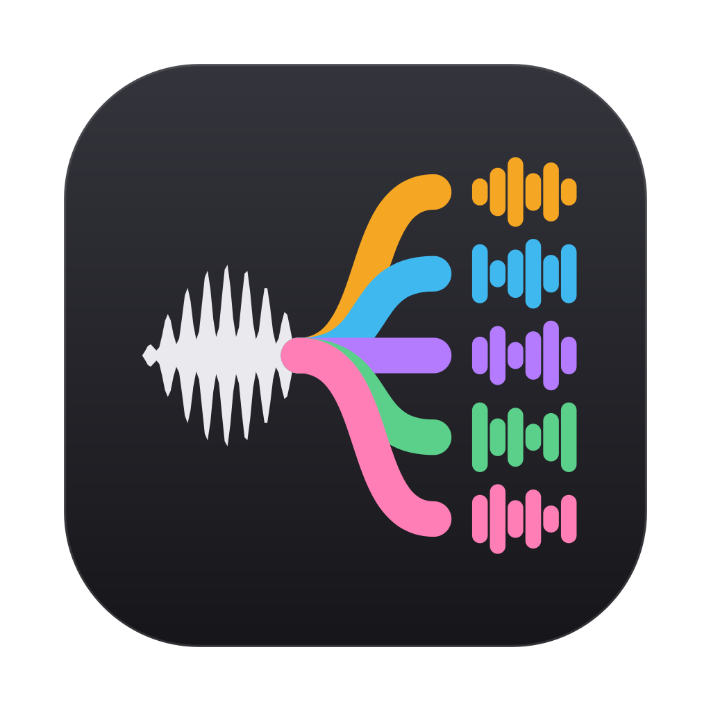
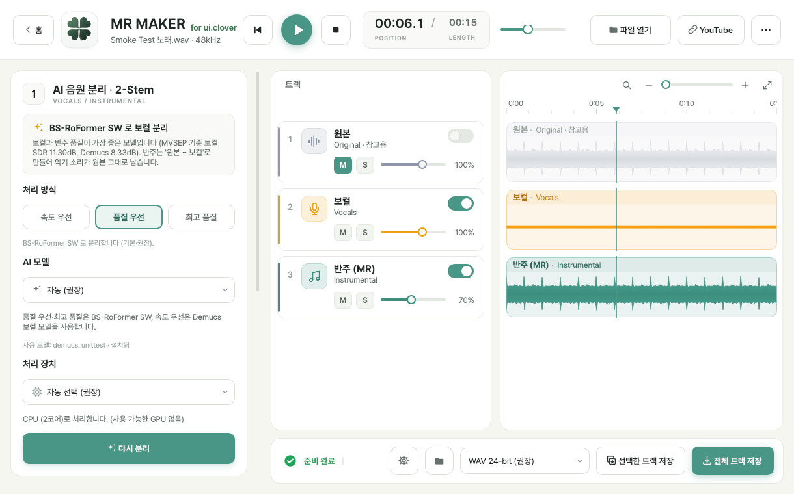

# MR MAKER for ui.clover

음원 파일이나 YouTube 주소 하나만 넣고 버튼 한 번으로 **보컬** 또는 **반주(MR)** 를 뽑는 Windows · macOS 데스크톱 프로그램입니다.
음악 모임의 보컬 연습용으로 만들었으며, 키(−12 ~ +12 반음)를 바꿔서 저장할 수도 있습니다.
AI 처리는 모두 내 컴퓨터에서 하고, 음원이 외부 서버로 전송되지 않습니다.

홈 화면 — 파일 또는 YouTube 주소 → 보컬/MR 선택 → 키 → 음원 추출 시작

고급 옵션 화면 (트랙별 재생·저장)

## 주요 기능

| 구분 | 내용 |
|---|---|
| 홈 화면 (원클릭) | 파일 끌어놓기 / 파일 선택 / YouTube 주소 붙여넣기 → **보컬만** 또는 **반주(MR)만** → 키 조절 → **[음원 추출 시작]**. 진행 단계와 남은 시간 표시, 끝나면 파일·폴더 열기 |
| YouTube 입력 | 오디오 전용 스트림 중 가장 좋은 것을 골라 **재인코딩 없이 원본 그대로** 받은 뒤 바로 처리 (MP3 같은 중간 변환 없음) |
| 분리 (2-Stem) | 보컬 / 반주. **품질 우선** BS-RoFormer SW · **속도 우선** Demucs htdemucs_ft 보컬 모델 · **최고 품질** 구간 4배 겹침. 기본값: **CPU 버전 = 속도 우선, CUDA 버전·Apple Silicon Mac = 품질 우선** |
| MR 만드는 방식 | **원본 − 보컬**. 남는 악기는 AI 를 거치지 않은 원본 그대로이고, 보컬 + MR = 원본 (샘플 단위로 일치) |
| 키 조절 | −12 ~ +12 반음, 템포·곡 길이 그대로. Rubber Band R3 엔진, 선택한 결과물에 한 번만 적용 (0 이면 처리 안 함). 보컬은 음색(포먼트) 유지 옵션 |
| 저장 | **WAV 24-bit (기본)** · FLAC (무손실 압축) · MP3 320kbps · WAV 32-bit float · WAV 16-bit |
| 음질 보호 | 원본 샘플레이트 유지, 고품질 리샘플러(soxr) 1회, 내부 처리 float32, 손실 압축은 마지막 MP3 저장 때 한 번만, 리미터·컴프레서·EQ·노멀라이즈 없음 |
| 고급 옵션 | 기존 화면: 트랙별 재생(M/S/볼륨, 파형), AI 모델·처리 방식·장치 선택, 출력 형식, 저장 위치, 트랙별/전체 저장, 가이드 보컬 MR |
| 가속 | NVIDIA GPU(CUDA) · Apple Silicon GPU(Metal) 자동 사용, 문제가 생기면 CPU 로 자동 재처리 |
| 입력 형식 | MP3, WAV, FLAC, M4A, AAC, OGG, OPUS, AIFF, WMA, 동영상(MP4, MOV, MKV, WEBM …)의 오디오 |

## 설치

[Releases](../../releases) 또는 GitHub Actions 빌드 결과(Artifacts)에서 내 컴퓨터에 맞는 파일을 받습니다.

| 컴퓨터 | 파일 |
|---|---|
| Windows 10/11 (64비트), NVIDIA 그래픽카드 있음 | `MRMaker-…-windows-x64-cuda-setup.exe` (+ 같은 폴더의 `.bin` 파일) |
| Windows 10/11 (64비트), 그 외 | `MRMaker-…-windows-x64-cpu-setup.exe` |
| Mac (M1·M2·M3·M4 등 Apple Silicon) | `MRMaker-…-macos-arm64.dmg` |
| Mac (Intel) | `MRMaker-…-macos-x86_64.dmg` |

Python, FFmpeg, PyTorch, yt-dlp 등은 모두 포함되어 있어 따로 설치할 필요가 없습니다.

**Windows** — 설치 파일을 실행합니다. 관리자 권한 없이 설치됩니다.
"Windows의 PC 보호" 창이 뜨면 *추가 정보 → 실행* 을 누릅니다 (코드 서명 전 빌드의 경우).
설치 없이 쓰려면 `…-portable.zip` 을 풀고 `MRMaker.exe` 를 실행합니다.
이전 버전을 쓰던 PC 에 설치하면 자동으로 교체되며, 설정과 내려받은 AI 모델은 그대로 유지됩니다.

**macOS** — DMG 를 열고 *MR MAKER for ui.clover* 를 *Applications* 폴더로 끌어다 놓습니다.
공증(Notarization)되지 않은 빌드라면 처음 한 번 *Control+클릭 → 열기* 를 누르거나
*시스템 설정 → 개인정보 보호 및 보안 → 그래도 열기* 를 누릅니다. macOS 12 이상이 필요합니다.

## 사용 방법

### 홈 화면 (기본)

1. 음원 파일을 끌어다 놓거나 **파일 선택**을 누릅니다. 또는 **YouTube URL** 칸에 영상 주소를 붙여넣습니다.
   지금 어느 입력을 쓸지 아래에 *사용할 입력: 파일 / YouTube* 로 표시됩니다.
2. **추출할 음원**에서 *보컬만* 또는 *반주(MR)만* 을 고릅니다 (기본: 반주).
3. 필요하면 **키 조절**을 바꿉니다 (−/+ 버튼, 슬라이더, 방향키·마우스 휠). *원래 키* 로 되돌립니다.
4. **[음원 추출 시작]** 을 누르면 입력 확인 → (YouTube 오디오 받기) → 디코딩 → AI 분리 → 키 조절 → 저장이 자동으로 진행됩니다.
5. 끝나면 *폴더 열기* / *파일 열기* 로 결과를 확인합니다. 같은 곡으로 다른 결과물(보컬 ↔ MR)이나 다른 키를 고르면
   분리를 다시 하지 않고 바로 저장합니다.

- 품질 우선을 처음 쓸 때 AI 모델(BS-RoFormer SW, 약 667MB)을 한 번 내려받습니다 (CPU 버전의 기본인 속도 우선 모델은 설치 파일에 포함). 저장 형식·위치는 오른쪽 위 ⚙ 에서 바꿉니다.
- 결과 파일: `저장 폴더/곡 이름/곡 이름 - MR (보컬 제거) [Key +2].wav` 처럼 저장됩니다.
- 그래픽카드 가속이 없는 PC 에서는 품질 우선 모드가 곡 길이의 수 배~10배 이상 걸릴 수 있습니다.
  진행 중 *빠른 모드로 다시* 를 누르거나 고급 옵션에서 *속도 우선* 을 고르면 훨씬 빨리 끝납니다 (품질은 낮아짐).

### YouTube 입력 안내

**본인이 권리를 가지고 있거나 권리자가 다운로드를 허락한 영상만** 사용해 주세요 (예: 본인·모임이 올린 영상,
크리에이티브 커먼즈 라이선스 영상). 허락 없이 저작물을 내려받는 것은 YouTube 서비스 약관과 저작권법에 위반될 수 있습니다.
처음 사용할 때 이 내용을 확인하는 창이 뜹니다. DRM 보호·비공개·회원 전용·연령 제한·실시간 방송·재생목록은 처리하지 않으며,
로그인(쿠키)을 사용하지 않습니다.

YouTube 가 바뀌어 받기가 실패하면 *고급 옵션 → ⋯ 메뉴 → YouTube 기능 업데이트* 로 최신 yt-dlp 를 받은 뒤
프로그램을 다시 시작하면 됩니다 (GitHub 공식 배포본, SHA-256 확인).

### 고급 옵션

홈 화면 오른쪽 위 **고급 옵션** 에서 기존의 상세 화면을 씁니다 (같은 곡이 이어서 열립니다, 왼쪽 위 *홈* 으로 돌아감).

- **처리 방식**: 속도 우선 / 품질 우선 / 최고 품질, **AI 모델**: 자동 / BS-RoFormer SW / Demucs, **처리 장치**: 자동 / GPU / CPU
- 트랙별 재생: **M** 음소거, **S** 솔로, 볼륨(0~150%), 파형 클릭으로 이동, `Ctrl`(⌘)+휠 확대
- **MR 저장 / 보컬 저장**, *가이드 보컬 작게 남기기*(MR 에 보컬을 0~50% 섞기)
- **키 조절** + *보컬 음색(포먼트) 유지*
- 아래 막대: 출력 형식, **선택한 트랙 저장**(스위치가 켜진 트랙), **전체 트랙 저장**, ⚙ 설정(저장 위치 등)

## 음질 원칙과 검증 결과

자세한 측정 방법과 수치는 **[docs/QUALITY.md](docs/QUALITY.md)** 에 있습니다. 요약:

- **분리 모델**: 정답 트랙이 있는 MUSDB18 테스트 50곡으로 직접 측정해 BS-RoFormer SW 를 기본으로 정했습니다
  (보컬 SDR 11.68dB / MR 16.92dB, Demucs htdemucs_ft 8.45 / 13.69dB, MR 에 남는 보컬 −28.6dB vs −21.6dB.
  공개 벤치마크 MVSEP Multisong 에서도 11.30 / 17.50dB vs 8.33 / 14.63dB 로 순위가 같음).
- **YouTube**: 오디오 전용 스트림을 코덱 등급(Opus > AAC …)으로 먼저 고르고 같은 코덱 안에서만 비트레이트를 비교, 음량 압축(DRC) 스트림 제외,
  받은 파일은 재인코딩하지 않고 FFmpeg 로 한 번 디코딩합니다. 원래 손실 압축된 음원이라 사라진 정보가 복원되지는 않습니다.
- **샘플레이트**: AI 입력이 44.1kHz 가 아닐 때만 soxr VHQ 로 한 번 변환합니다. 보컬은 모델 출력(44.1kHz) 그대로 저장하고,
  MR 은 원본 샘플레이트에서 '원본 − 보컬' 로 만들어 악기를 리샘플링하지 않습니다.
- **키 조절**: Rubber Band R3 와 Signalsmith Stretch 를 비교 측정해 음정 정확도(오차 0.0센트)·스테레오 보존이 더 좋은 Rubber Band 를 사용합니다.
  키를 크게(±7 이상) 바꿀수록 어떤 알고리즘이든 음질 변화가 커집니다.
- **피크**: 리미터 없이, 정수 형식이 0dBFS 를 넘을 때만 고정 배율로 음량을 낮춥니다 (MP3 는 트루 피크 −1dBTP 기준).
- WAV·FLAC 으로 저장해도 입력 음원과 AI 모델의 한계를 넘는 음질이 생기지는 않습니다.

### 인터넷이 없는 PC 에서 쓰기

배포 파일에는 속도 우선 모델(htdemucs_ft 보컬, 약 80MB)이 포함되어 있어 인터넷 없이도 *속도 우선* 으로 쓸 수 있습니다.
품질 우선 모델(BS-RoFormer SW)은 인터넷이 되는 PC 에서 한 번 받은 뒤 *고급 옵션 → ⋯ 메뉴 → AI 모델 폴더 열기* 의 폴더를 복사해
오프라인 PC 에서 *⋯ 메뉴 → AI 모델 가져오기* 로 넣으면 됩니다.

| | 모델 저장 위치 |
|---|---|
| Windows | `%LOCALAPPDATA%\MusicSeparator\models` |
| macOS | `~/Library/Application Support/Music Separator/models` |

### 문제 해결

| 증상 | 해결 |
|---|---|
| YouTube: "자동 접근 확인을 요구" | YouTube 가 자동 접근을 막은 경우입니다. 잠시 후 다시 시도하거나 다른 네트워크에서 시도하세요. |
| YouTube: "다운로드 도구 업데이트가 필요" | *⋯ 메뉴 → YouTube 기능 업데이트* 후 프로그램을 다시 시작하세요. |
| YouTube: 비공개·연령 제한·회원 전용 | 로그인이 필요한 영상은 지원하지 않습니다. |
| 너무 오래 걸림 | 그래픽카드 가속이 없는 PC 입니다. *빠른 모드로 다시* 또는 고급 옵션의 *속도 우선* 을 쓰세요. |
| "GPU 처리 중 문제가 발생하여 CPU로 다시 처리합니다" | 그래픽 드라이버를 최신으로 업데이트하세요. 처리 결과는 CPU 로 정상 완료됩니다. |
| 메모리 부족 | 다른 프로그램을 닫거나 곡을 짧게 잘라 주세요. 4분 곡 기준 약 3GB 여유 메모리가 필요합니다. |
| 모델 다운로드 실패 | 회사 방화벽이 `github.com` / `huggingface.co` / `dl.fbaipublicfiles.com` 을 막는 경우입니다. 위의 오프라인 방법을 쓰세요. |
| 기타 오류 | 오류 창의 *다시 시도* 를 누르거나, *고급 옵션 → ⋯ 메뉴 → 로그 폴더 열기* 의 `music_separator.log` 를 확인하세요. |

## 개발자용

- 소스 실행, 테스트, 직접 빌드, GitHub Actions 자동 빌드, 코드 서명·공증: **[docs/BUILD.md](docs/BUILD.md)**
- 음질 측정 방법과 결과: **[docs/QUALITY.md](docs/QUALITY.md)**
- 사용한 오픈소스와 라이선스: **[THIRD_PARTY_NOTICES.md](THIRD_PARTY_NOTICES.md)**

분리된 음원의 저작권은 원곡의 권리자에게 있습니다. 개인 연습·학습 용도로 사용해 주세요.
