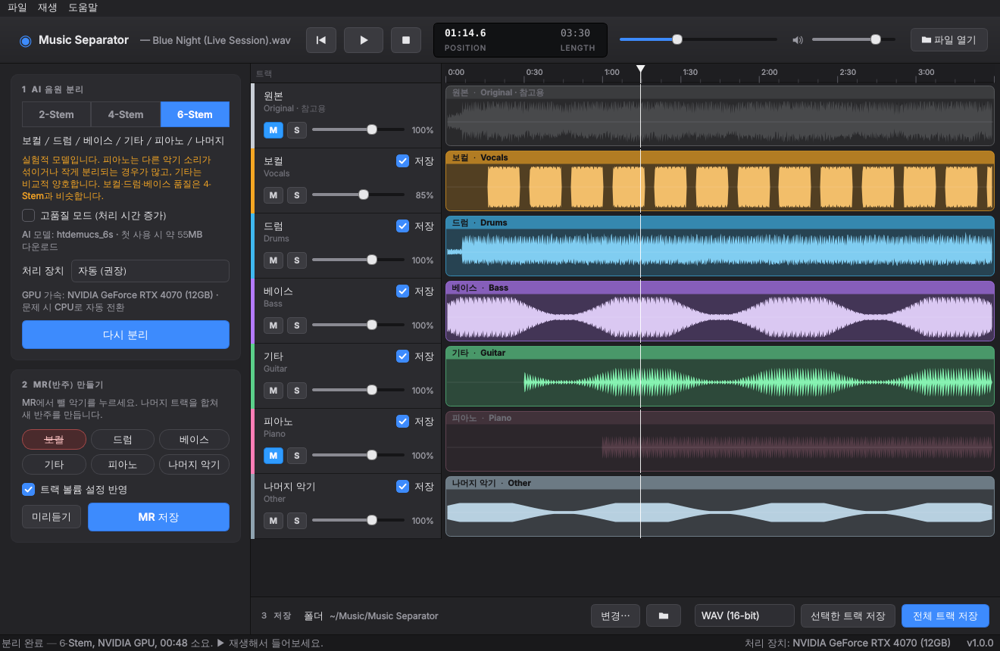

# Music Separator

Windows · macOS 에서 동작하는 **AI 음원 분리 데스크톱 프로그램**입니다.
Meta AI 의 [Demucs](https://github.com/adefossez/demucs) 모델로 노래를 보컬·드럼·베이스·기타·피아노 등으로 나누고,
프로그램 안에서 바로 들어 보면서 원하는 악기만 빼고 MR(반주)을 만들 수 있습니다.
인터넷 없이 내 컴퓨터에서 처리되며, 음원이 외부로 전송되지 않습니다.

화면 예시 (테스트 신호로 렌더링한 6-Stem 결과)

## 주요 기능

| 구분 | 내용 |
|---|---|
| 분리 모드 | **2-Stem** 보컬 / 반주 · **4-Stem** 보컬 / 드럼 / 베이스 / 기타 악기 · **6-Stem** 보컬 / 드럼 / 베이스 / 기타 / 피아노 / 나머지 |
| 고품질 모드 | 2·4-Stem: 미세조정 모델 4개(htdemucs_ft) 사용 · 6-Stem: 2회 처리 평균 |
| 재생 | 모든 트랙 동시 재생, 트랙별 **M**(음소거) · **S**(솔로) · 볼륨, 파형 클릭으로 위치 이동 |
| MR 만들기 | 뺄 악기를 고르면 나머지를 합쳐 저장 (예: 보컬 제외 = 노래방 MR, 드럼 제외 = 드럼 연습용) |
| 저장 | 선택한 트랙 / 전체 트랙을 WAV(16·24-bit) 또는 MP3(320kbps)로 저장, 저장 폴더 선택 |
| 가속 | NVIDIA GPU(CUDA) · Apple Silicon GPU(Metal) 자동 사용, 실패 시 CPU 로 자동 재처리 |
| 안정성 | 처리 중에도 화면이 멈추지 않음, 언제든 취소, 메모리·디스크 부족 사전 안내 |
| 입력 형식 | MP3, WAV, FLAC, M4A, AAC, OGG, OPUS, AIFF, WMA, 동영상(MP4, MOV, MKV …)의 오디오 |

## 설치

[Releases](../../releases) 또는 GitHub Actions 빌드 결과(Artifacts)에서 내 컴퓨터에 맞는 파일을 받습니다.

| 컴퓨터 | 파일 |
|---|---|
| Windows 10/11 (64비트), NVIDIA 그래픽카드 있음 | `MusicSeparator-…-windows-x64-cuda-setup.exe` (+ 같은 폴더의 `.bin` 파일) |
| Windows 10/11 (64비트), 그 외 | `MusicSeparator-…-windows-x64-cpu-setup.exe` |
| Mac (M1·M2·M3·M4 등 Apple Silicon) | `MusicSeparator-…-macos-arm64.dmg` |
| Mac (Intel) | `MusicSeparator-…-macos-x86_64.dmg` |

Python, FFmpeg, PyTorch 등은 모두 포함되어 있어 따로 설치할 필요가 없습니다.

**Windows** — 설치 파일을 실행합니다. 관리자 권한 없이 설치됩니다.
"Windows의 PC 보호" 창이 뜨면 *추가 정보 → 실행* 을 누릅니다 (코드 서명 전 빌드의 경우).
설치 없이 쓰려면 `…-portable.zip` 을 풀고 `MusicSeparator.exe` 를 실행합니다.

**macOS** — DMG 를 열고 *Music Separator* 를 *Applications* 폴더로 끌어다 놓습니다.
공증(Notarization)되지 않은 빌드라면 처음 한 번 *Control+클릭 → 열기* 를 누르거나
*시스템 설정 → 개인정보 보호 및 보안 → 그래도 열기* 를 누릅니다. macOS 12 이상이 필요합니다.

## 사용 방법

1. 음악 파일을 창에 끌어다 놓거나 **파일 열기**를 누릅니다.
2. 왼쪽에서 **2-Stem / 4-Stem / 6-Stem** 중 하나를 고르고 **분리 시작**을 누릅니다.
   - 처음 한 번은 AI 모델을 내려받습니다 (기본 빌드에는 htdemucs·htdemucs_6s 가 포함되어 있어 바로 시작).
   - 진행률과 남은 시간이 표시되고, **취소**로 언제든 멈출 수 있습니다.
3. 분리가 끝나면 **▶ (Space)** 로 재생합니다.
   - **M** 음소거, **S** 솔로(이 트랙만), 슬라이더로 볼륨(0~150%), 슬라이더 더블클릭 = 100%
   - 파형이나 위쪽 시간 눈금을 클릭/드래그하면 그 위치로 이동합니다. `Home` = 처음으로
4. **MR 만들기**: 뺄 악기 버튼(빨간 취소선 = 제외)을 고른 뒤 **미리듣기**로 확인하고 **MR 저장**.
   *트랙 볼륨 설정 반영*을 켜면 각 트랙 볼륨 슬라이더 값이 MR 에 적용됩니다.
5. **저장**(아래 막대): 형식과 폴더를 고르고 **선택한 트랙 저장**(트랙 옆 '저장' 체크) 또는 **전체 트랙 저장**.
   파일은 `저장 폴더/곡 이름/곡 이름 - 보컬 (Vocals).wav` 처럼 저장됩니다.

### 분리 품질 안내

- **4-Stem(htdemucs)** 이 Demucs 의 기본이자 가장 안정적인 모드입니다. 4-Stem 의 '기타 악기'에는 기타·피아노·신스·현악기 등이 함께 들어갑니다.
- **6-Stem(htdemucs_6s)** 은 Demucs 가 공식적으로 *실험적* 이라고 밝힌 모델입니다.
  기타는 비교적 쓸 만하지만, **피아노는 품질이 낮은 편**이라 소리가 작게 나오거나 '나머지 악기'로 새는 경우가 많습니다.
  보컬·드럼·베이스는 4-Stem 과 비슷합니다. 깨끗한 MR 이 목적이면 2-Stem 또는 4-Stem 을 권장합니다.
- 리버브가 강한 보컬, 보컬과 같은 음역의 악기(색소폰, 리드 신스), 라이브 녹음은 잔향이 남을 수 있습니다.
- 처리 시간(대략): NVIDIA GPU 는 4분 곡 기준 수십 초, Apple Silicon 은 1분 안팎, CPU 는 코어 수에 따라 1~5분 이상.
  고품질 모드는 2~4배 더 걸립니다.

### 인터넷이 없는 PC 에서 쓰기

기본 배포 파일에는 htdemucs(2·4-Stem)와 htdemucs_6s(6-Stem) 모델이 포함되어 있어 바로 오프라인으로 쓸 수 있습니다.
고품질 모델(htdemucs_ft)처럼 포함되지 않은 모델은 인터넷이 되는 PC 에서 한 번 받은 뒤
*도움말 → AI 모델 폴더 열기* 의 폴더를 복사해 오프라인 PC 에서 *도움말 → AI 모델 가져오기* 로 넣으면 됩니다.

| | 모델 저장 위치 |
|---|---|
| Windows | `%LOCALAPPDATA%\MusicSeparator\models` |
| macOS | `~/Library/Application Support/Music Separator/models` |

### 문제 해결

| 증상 | 해결 |
|---|---|
| "GPU 처리 중 문제가 발생하여 CPU로 다시 처리합니다" | 그래픽 드라이버를 최신으로 업데이트하세요. 처리 결과는 CPU 로 정상 완료됩니다. |
| 메모리 부족 경고 | 다른 프로그램을 닫거나 곡을 짧게 잘라 주세요. 4분 곡 기준 약 3GB 여유 메모리가 필요합니다. |
| 소리가 안 남 | 출력 장치(스피커/헤드폰)를 확인하세요. 재생이 안 되어도 분리·저장은 정상 동작합니다. |
| 모델 다운로드 실패 | 회사 방화벽이 `huggingface.co` / `dl.fbaipublicfiles.com` 을 막는 경우입니다. 위의 오프라인 방법을 쓰세요. |
| 기타 오류 | *도움말 → 로그 폴더 열기* 의 `music_separator.log` 를 확인하세요. |

## 개발자용

- 소스 실행, 테스트, 직접 빌드, GitHub Actions 자동 빌드, 코드 서명·공증: **[docs/BUILD.md](docs/BUILD.md)**
- 사용한 오픈소스와 라이선스: **[THIRD_PARTY_NOTICES.md](THIRD_PARTY_NOTICES.md)**

분리된 음원의 저작권은 원곡의 권리자에게 있습니다. 개인 연습·학습 용도로 사용해 주세요.
